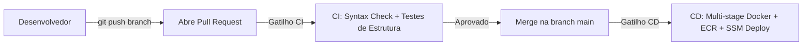

# Agent Backend

Backend em Python para um agente de IA com FastAPI, LangChain e Google Gemini. O projeto recebe mensagens do cliente, pode receber contexto de processo em `dados_processo`, preserva histórico por `session_id` no LangGraph e responde em um formato estruturado para uso em API e diagnósticos.

## Status atual

A aplicação já conta com:
- API FastAPI com rotas de chat
- agente LangChain conectado ao modelo Gemini
- camada de serviço para orquestrar o pipeline
- suporte a `dados_processo` no payload da requisição
- resposta em dois blocos: `resumo_response` e `raw_response`
- limpeza de sessão/thread por `session_id`
- cliente local em `run_local.py` executando o fluxo pela service

## Estrutura do projeto

```text
Agent-Backend/
├── src/
│   ├── main.py                    # entrypoint para execução do uvicorn
│   └── app/
│       ├── main.py                # inicializa o FastAPI e registra os roteadores
│       ├── agent/
│       │   ├── __init__.py
│       │   ├── agent.py           # instancia LLM e compila o agente via grafo
│       │   ├── graph.py           # nós (agent, tools), arestas e StateGraph
│       │   ├── graph_state.py     # definição do AgentState (mensagens, dados_processo, llm_calls)
│       │   ├── memory.py          # gerenciamento de memória (InMemorySaver) e limpeza de threads
│       │   ├── prompts.py         # prompt do sistema da MarIA e regras de negócio
│       │   └── tools.py           # ferramentas disponíveis para o agente
│       ├── config/
│       │   ├── __init__.py
│       │   └── settings.py        # leitura das variáveis de ambiente com Pydantic
│       ├── routes/
│       │   ├── __init__.py
│       │   └── chat.py            # endpoints da API de chat
│       ├── schemas/
│       │   ├── __init__.py
│       │   └── chat.py            # contratos de request/response Pydantic da API
│       └── services/
│           ├── __init__.py
│           └── agent_service.py   # orquestração de chamadas ao agente e fluxo de resposta
├── tests/
│   ├── test_api_structure.py      # valida a estrutura da API
│   ├── test_graph.py              # valida nós, estado e roteamento do grafo LangGraph
│   └── test_service.py            # valida a camada de serviço
├── .env.example                   # exemplo de variáveis de ambiente
├── .gitignore                     # arquivos ignorados pelo Git
├── Dockerfile                     # imagem para executar a API
├── README.md                      # documentação do projeto
├── requirements.txt               # dependências do Python
├── run_local.py                   # cliente local para testar o agente via service
└── .env                           # ambiente local (não versionado)
```

## Responsabilidades dos módulos

### `src/app/main.py`
Cria a instância do FastAPI, configura CORS e inclui os roteadores da API.

### `src/app/routes/chat.py`
Define os endpoints:
- `POST /api/v1/chat`
- `DELETE /api/v1/chat/{session_id}`

### `src/app/schemas/chat.py`
Define os contratos de entrada e saída (DTOs / Pydantic models):
- `ChatRequest`
- `ChatResponse`
- `ResumoResponse`
- `ChatDeleteResponse`


### `src/app/services/agent_service.py`
Orquestra o fluxo completo do agente:
1. valida e normaliza a mensagem
2. prepara o contexto do processo
3. invoca o grafo com `HumanMessage`
4. extrai a resposta gerada
5. retorna `resposta` e `raw_response`

### `src/app/agent/graph_state.py`
Define o `AgentState` com:
- `messages`: histórico de mensagens gerenciado com o redutor `add_messages`
- `dados_processo`: dados do processo jurídico com redutor para persistência entre turnos
- `llm_calls`: contador de execuções do modelo de linguagem

### `src/app/agent/graph.py`
Monta a arquitetura de grafo do LangGraph (`StateGraph`).

### `src/app/agent/agent.py`
Configura o cliente Gemini (`ChatGoogleGenerativeAI`), vincula as ferramentas de `tools.py` e compila o grafo com `InMemorySaver`.

### `src/app/agent/memory.py`
Gerencia a instância de `InMemorySaver` e a remoção de sessões/threads (`delete_thread`).

### `src/app/agent/tools.py`
Define ferramentas acessíveis ao agente.

### `src/app/agent/prompts.py`
Centraliza o prompt do sistema e as diretrizes da assistente MarIA.

### `src/app/config/settings.py`
Carrega as variáveis de ambiente do projeto com `pydantic-settings`.

## Requisitos

- Python 3.10+
- chave da API do Google Gemini
- acesso à internet para chamadas ao modelo

## Configuração do ambiente

Crie um arquivo `.env` na raiz do projeto com:

```env
LLM_API_KEY=sua-chave-do-google-gemini
LLM_MODEL=gemini-2.5-flash
```

Observações:
- `LLM_MODEL` deve ser um modelo aceito pelo `ChatGoogleGenerativeAI`
- não versionar chaves reais no repositório

## Instalação

```bash
python -m venv venv
source venv/Scripts/activate
python -m pip install --upgrade pip
pip install -r requirements.txt
```

No PowerShell:

```powershell
python -m venv venv
.\venv\Scripts\Activate.ps1
python -m pip install --upgrade pip
pip install -r requirements.txt
```

## Execução local

### Cliente interativo

```bash
python run_local.py
```

Esse cliente envia mensagem por mensagem para a service do agente e é útil para testes manuais sem depender de um frontend.

### API FastAPI

```bash
uvicorn src.app.main:app --reload

# Para permitir conexão externa
uvicorn src.app.main:app --host 0.0.0.0 --port 8000 --reload
```

A API fica disponível em:

```text
http://127.0.0.1:8000
```

## Endpoints da API

### POST `/api/v1/chat`

Cria ou reutiliza uma conversa por `session_id`.

Payload de exemplo:

```json
{
  "message": "Olá, preciso de ajuda com meu processo",
  "session_id": "sessao-123",
  "dados_processo": {
    "cliente": {
      "nome": "João Pereira",
      "cpf": "123.456.789-09",
      "telefone": "(11) 99999-1234",
      "ativo": true
    },
    "descricaoCaso": "Ação de cobrança referente a contrato de prestação de serviços com atraso de pagamentos.",
    "observacao": "Cliente solicitou revisão do valor cobrado e encaminhamento para mediação.",
    "prioridade": {
      "nome": "Alta",
      "peso": 10
    },
    "faseProcesso": {
      "nome": "Em andamento",
      "ordem": 3
    },
    "ultimaAtualizacao": "2026-08-29T15:30:00",
    "dataHoraInicio": "2026-07-15T09:00:00",
    "ativo": true,
    "dataAudiencia": "2026-09-10T14:00:00",
    "encerradoEm": null,
    "encerradoPorUsuario": null,
    "siglaTribunal": {
      "sigla": "TJSP",
      "nome": "Tribunal de Justiça de São Paulo"
    },
    "valorCausa": 18500.75
  }
}
```

Resposta esperada:

```json
{
  "resumo_response": {
    "response": "Resposta final do assistente",
    "session_id": "sessao-123"
  },
  "raw_response": {
    "messages": [
      "..."
    ],
    "dados_processo": {
      "cliente": {
        "nome": "João Pereira",
        "cpf": "123.456.789-09",
        "telefone": "(11) 99999-1234",
        "ativo": true
      },
      "descricaoCaso": "Ação de cobrança referente a contrato de prestação de serviços com atraso de pagamentos.",
      "observacao": "Cliente solicitou revisão do valor cobrado e encaminhamento para mediação.",
      "prioridade": {
        "nome": "Alta",
        "peso": 10
      },
      "faseProcesso": {
        "nome": "Em andamento",
        "ordem": 3
      },
      "ultimaAtualizacao": "2026-08-29T15:30:00",
      "dataHoraInicio": "2026-07-15T09:00:00",
      "ativo": true,
      "dataAudiencia": "2026-09-10T14:00:00",
      "encerradoEm": null,
      "encerradoPorUsuario": null,
      "siglaTribunal": {
        "sigla": "TJSP",
        "nome": "Tribunal de Justiça de São Paulo"
      },
      "valorCausa": 18500.75
    }
  }
}
```

### DELETE `/api/v1/chat/{session_id}`

Remove a conversa daquele `session_id` do histórico do agente.

Exemplo de resposta:

```json
{
  "message": "Chat excluído com sucesso",
  "session_id": "sessao-123"
}
```

Se a thread não existir, retorna `404`.

## Fluxo atual da aplicação

```text
Cliente / curl / browser
        |
        v
FastAPI
        |
        v
src.app.routes.chat
        |
        v
src.app.services.agent_service
        |
        v
LangChain + Gemini Agent
        |
        v
Resposta final + raw_response
```

### Etapas do fluxo

1. A requisição chega no endpoint `/api/v1/chat`.
2. O schema valida o payload, incluindo `dados_processo`.
3. O router chama `executarPipelineAgente`.
4. A service normaliza a mensagem, prepara o contexto e envia a conversa ao agente.
5. O agente processa a mensagem com o LangGraph e o `session_id`.
6. A service extrai o texto final e o payload bruto.
7. A API devolve `resumo_response` e `raw_response`.
8. Quando solicitado, o endpoint de exclusão remove a thread do checkpointer do LangGraph.

## Docker

O `Dockerfile` prepara a imagem para rodar a API com Uvicorn. Em produção, é recomendável:
- configurar `LLM_API_KEY` via ambiente ou secret manager
- usar uma imagem Python fixa e testada
- não armazenar segredos no código-fonte

## Observações finais

O projeto já está em um estágio funcional de protótipo e arquitetura base pronta para evolução. A próxima etapa natural é expandir `tools`, `prompts` e a modelagem de domínio para casos reais de negócio, mantendo a estrutura da API e o controle de sessão por `session_id`.


---

## 🚀 Fluxo de Integração e Entrega Contínua (CI/CD)

O microserviço do **Agent MarIA** utiliza esteira de automação com **GitHub Actions**:



### 1. Integração Contínua (CI) — `.github/workflows/ci.yml`
* **Gatilho:** Todo **Pull Request** para `main` ou `develop`.
* **Ações:**
  * Configura ambiente Python 3.12 com dependências enxutas.
  * Valida a sintaxe completa do código com `py_compile`.
  * Executa os testes de estrutura de rotas da API com `unittest` e validação do Pydantic.

### 2. Entrega Contínua (CD) — `.github/workflows/cd.yml`
* **Gatilho:** Todo **Push / Merge** na branch `main`.
* **Ações:**
  * Constrói a imagem Docker utilizando o **Dockerfile Multi-Stage** (estágio `builder` isola compilação e estágio `runner` produz imagem leve com usuário não-root).
  * Faz o push da imagem para o **Amazon ECR (`sgpj-agent:latest`)**.
  * Atualiza o container `sgpj-agent` nas instâncias de backend privadas (`ec2-backend-a` e `ec2-backend-b`) via **AWS SSM**.
