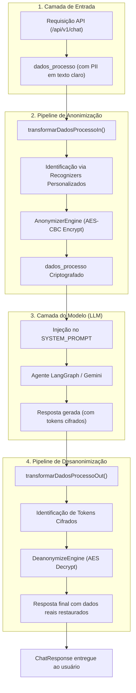

# Arquitetura de Anonimização e Desanonimização Reversível

Este documento descreve detalhadamente o funcionamento, os princípios criptográficos e as implementações do sistema de **anonimização reversível e desanonimização de dados** do `Agent-Backend`, desenvolvido com base no **Microsoft Presidio** e no **spaCy**.

---

## 1. Visão Geral e Princípio de Funcionamento

O objetivo deste módulo é garantir a **privacidade de dados sensíveis (PII)** e a conformidade com a **LGPD (Lei Geral de Proteção de Dados)**, impedindo que informações pessoais e confidenciais de processos jurídicos e clientes sejam enviadas em texto aberto para Provedores de Modelos de Linguagem (LLMs, ex: Google Gemini, OpenAI).

### Anonimização Reversível vs. Irreversível

Ao contrário da anonimização destrutiva (como substituição fixa por `<CPF>` ou máscara `***`), este sistema adota a **anonimização reversível criptográfica**:

1. **Entrada (Antes do LLM):** Os dados sensíveis identificados são criptografados com o algoritmo simétrico **AES (Advanced Encryption Standard)** em modo **CBC**, com vetor de inicialização aleatório (**IV de 16 bytes**) e preenchimento **PKCS7**. O resultado é codificado em **Base64 URL-safe**.
2. **Processamento pelo LLM:** O LLM recebe o contexto estruturado contendo apenas os tokens criptografados (ex: `DJJCE-kyp90LBzgkZu-7Usv0eKfmfSFtvf7CDypv4D4=`). O modelo consegue raciocinar sobre as relações dos dados sem ter acesso ao dado real.
3. **Saída (Após o LLM):** Quando o LLM cita ou responde mencionando algum dado cifrado, o sistema identifica os tokens na resposta e executa a **desanonimização**, restaurando os valores originais antes de entregá-los ao usuário final na API.



---

## 2. Estrutura de Diretórios

O módulo de anonimização foi organizado em um subpacote dedicado para manter a codebase limpa e modular:

```
src/app/services/anonymizer/
├── __init__.py           # Exporta a interface pública limpa do módulo
├── recognizers.py        # 6 Recognizers brasileiros com algoritmos de validação
├── engine.py             # Configuração e inicialização singleton dos motores Presidio
└── service.py            # Funções de anonimização recursiva e desanonimização de saída
```

---

## 3. Detalhamento dos Recognizers Personalizados (`recognizers.py`)

Arquivo: [`src/app/services/anonymizer/recognizers.py`](file:///C:/Users/leona/OneDrive/Área%20de%20Trabalho/Agent-Backend/src/app/services/anonymizer/recognizers.py)

Cada classe estende `PatternRecognizer` da biblioteca `presidio_analyzer` e implementa o método `validate_result(self, pattern_text: str) -> bool`. Quando este método retorna `True`, o Presidio eleva a pontuação da detecção para o valor máximo (`1.0`); quando retorna `False`, o resultado é descartado (`score = 0.0`), prevenindo falsos positivos.

### 3.1. `CpfRecognizer` (Entidade: `BR_CPF`)

Detecta o Cadastro de Pessoas Físicas em formatos pontuados e puramente numéricos.

- **Padrões Regex:**
  - `cpf_formatado`: `\b\d{3}\.\d{3}\.\d{3}-\d{2}\b` (score base: `0.85`)
  - `cpf_apenas_digitos`: `\b\d{11}\b` (score base: `0.40`)
- **Palavras de Contexto:** `"cpf"`, `"cadastro de pessoa fisica"`, `"documento"`, `"titular"`, `"beneficiario"`.
- **Função `validate_result(pattern_text)`:**
  1. Extrai apenas os dígitos numéricos.
  2. Verifica se o comprimento é igual a 11 e rejeita sequências com todos os dígitos iguais (ex: `111.111.111-11`).
  3. Calcula o **1º Dígito Verificador**:
     $$\text{d}_1 = \left(\sum_{i=0}^{8} \text{digito}_i \times (10 - i) \times 10 \pmod{11}\right) \pmod{10}$$
  4. Calcula o **2º Dígito Verificador**:
     $$\text{d}_2 = \left(\sum_{i=0}^{9} \text{digito}_i \times (11 - i) \times 10 \pmod{11}\right) \pmod{10}$$
  5. Retorna `True` se ambos coincidirem exatamente com os dígitos do CPF analisado.

---

### 3.2. `CnpjRecognizer` (Entidade: `BR_CNPJ`)

Suporta tanto o **CNPJ numérico tradicional** quanto o novo **CNPJ Alfanumérico**, regulamentado pela **Instrução Normativa RFB nº 2.229/2024**.

- **Estrutura Suportada:**
  - 14 caracteres: 12 caracteres alfanuméricos (`0-9` e `A-Z`) na raiz e ordem/filial + 2 dígitos verificadores obrigatoriamente numéricos.
  - Formatado: `XX.XXX.XXX/XXXX-NN` (ex: `09.904.401/0001-40`, `E7.ZQS.52V/0001-08`).
  - Sem formatação: 14 caracteres diretos (ex: `12ABC34501DE35`).
- **Padrões Regex:**
  - `cnpj_formatado`: `(?<![0-9A-Za-z])\b[0-9A-Za-z]{2}\.[0-9A-Za-z]{3}\.[0-9A-Za-z]{3}/[0-9A-Za-z]{4}-\d{2}(?![0-9A-Za-z])\b`
  - `cnpj_sem_formato`: `(?<![0-9A-Za-z])\b[0-9A-Za-z]{12}\d{2}(?![0-9A-Za-z])\b`
- **Função `validate_result(pattern_text)`:**
  1. Normaliza a string removendo separadores e aplicando `.upper()`.
  2. Rejeita strings com tamanho diferente de 14 ou caracteres todos repetidos.
  3. Valida se as duas últimas posições são dígitos numéricos.
  4. Converte cada caractere conforme a **regra oficial da Receita Federal (Tabela ASCII)**:
     $$\text{valor} = \text{ord}(c) - 48$$
     *(Dígitos '0'-'9' valem de 0 a 9; letras 'A'-'Z' valem de 17 a 42).*
  5. Aplica os pesos do Módulo 11:
     - Pesos 1º DV: `[5, 4, 3, 2, 9, 8, 7, 6, 5, 4, 3, 2]`
     - Pesos 2º DV: `[6, 5, 4, 3, 2, 9, 8, 7, 6, 5, 4, 3, 2]`
  6. Se o resto da divisão por 11 for 0 ou 1, o DV é 0; caso contrário, é $11 - \text{resto}$.

---

### 3.3. `RgRecognizer` (Entidade: `BR_RG`)

Reconhece Carteiras de Identidade estaduais emitidas pelas Secretarias de Segurança Pública (SSP, Detran, etc.).

- **Padrões Regex:**
  - `rg_formatado_padrao`: `(?<!\d)\b\d{1,2}\.\d{3}\.\d{3}-[\dXx](?![\dXx])\b` (permite dígito verificador numérico ou `X`/`x`).
  - `rg_formatado_sem_hifen`: `(?<!\d)\b\d{1,2}\.\d{3}\.\d{3}(?![\d/])\b` (utiliza o lookahead negativo `(?![\d/])` para impedir que o prefixo de um CNPJ seja identificado erroneamente como RG).
  - `rg_sem_formato`: `(?<!\d)\b\d{7,8}[\dXx](?![\dXx])\b` (score base baixo de 0.35, ativado mediante contexto).
- **Palavras de Contexto:** `"rg"`, `"identidade"`, `"registro geral"`, `"cedula de identidade"`, `"carteira de identidade"`, `"ssp"`, `"detran"`, `"expedicao"`, `"emissor"`.
- **Função `validate_result(pattern_text)`:**
  - Descarta sequências com todos os dígitos repetidos (ex: `00.000.000-0`).

---

### 3.4. `BrazilPhoneRecognizer` (Entidade: `PHONE_NUMBER`)

Substitui e estende o reconhecedor nativo do Presidio, solucionando a falha que impedia a detecção de telefones fixos (como `1103030303` ou `(11) 0303-0303`).

- **Padrões Regex:**
  1. `br_phone_celular_formatado`: `(?<!\d)(?:\+?55\s?)?(?:\([1-9][0-9]\)\s?|[1-9][0-9]\s?)9\s?\d{4}[-\s]?\d{4}(?!\d)`
  2. `br_phone_fixo_formatado`: `(?<!\d)(?:\+?55\s?)?(?:\([1-9][0-9]\)\s?|[1-9][0-9]\s?)[0-9]\d{3}[-\s]?\d{4}(?!\d)`
  3. `br_phone_local_formatado`: `(?<!\d)(?:9\s?\d{4}|[0-9]\d{3})[-\s]\d{4}(?!\d)`
  4. `br_phone_0800`: `(?<!\d)0[38]00[-\s]?\d{3}[-\s]?\d{4}(?!\d)`
  5. `br_phone_celular_sem_formato`: `(?<!\d)(?:\+?55)?[1-9][0-9]9\d{8}(?!\d)` (exatamente 11 dígitos com 9 na 3ª posição).
  6. `br_phone_fixo_sem_formato`: `(?<!\d)(?:\+?55)?[1-9][0-9][0-9]\d{7}(?!\d)` (exatamente 10 dígitos, ex: `1103030303`).
- **Palavras de Contexto:** `"telefone"`, `"celular"`, `"tel"`, `"contato"`, `"whatsapp"`, `"whats"`, `"fone"`, `"fixo"`, `"ligar"`.

---

### 3.5. `RazaoSocialRecognizer` (Entidade: `BR_RAZAO_SOCIAL`)

Identifica nomes corporativos e razões sociais no Brasil, corrigindo a falha do spaCy que classificava empresas terminadas em nomes próprios ou siglas como `PERSON` ou `LOCATION`.

- **Sufixos Jurídicos Suportados:**
  `LTDA`, `Ltda.`, `LIMITADA`, `S.A.`, `S/A`, `EIRELI`, `ME`, `M.E.`, `EPP`, `E.P.P.`, `MEI`, `S/S`, `SPE`, `CIA`, `COMPANHIA`, `HOLDING`.
- **Filtro de Início Negativo:**
  Impede a captura de palavras introdutórias da frase (como `"Contrato com"`, `"A empresa"`, `"Fornecedor"`).
- **Padrão Regex:**
  Exige palavras capitalizadas/conectivos seguidas obrigatoriamente por um dos sufixos jurídicos:
  ```regex
  \b(?!Contrato\b|Empresa\b|Fornecedor\b|Cliente\b|Entre\b|Pela\b|Pelo\b|Com\b)(?:[A-ZÀ-Ú][a-zà-ú0-9]+|[A-ZÀ-Ú0-9]{2,})(?:\s+(?:(?:[A-ZÀ-Ú][a-zà-ú0-9]+|[A-ZÀ-Ú0-9]{2,})|(?:de|da|do|dos|das|e|em|para|com|&|\-))){1,8}\s+(?:LTDA\.?|...)(?!\w)
  ```
- **Score (0.90):** Superior ao modelo padrão do spaCy (`0.85`), garantindo que o Presidio priorize a entidade `BR_RAZAO_SOCIAL`.

---

### 3.6. `CnjRecognizer` (Entidade: `BR_CNJ`)

Identifica o Número Único de Processos do Poder Judiciário conforme a **Resolução nº 65/2008 do Conselho Nacional de Justiça (CNJ)**.

- **Estrutura (20 dígitos):**
  $$\text{NNNNNNN-DD.AAAA.J.TR.OOOO}$$
  - `NNNNNNN` (7): Número sequencial
  - `DD` (2): Dígitos verificadores
  - `AAAA` (4): Ano do ajuizamento
  - `J` (1): Órgão da Justiça (1: STF, 2: CNJ, 3: STJ, 4: Federal, 5: Trabalho, 6: Eleitoral, 7: Militar União, 8: Estadual, 9: Militar Estadual)
  - `TR` (2): Tribunal respectivo
  - `OOOO` (4): Unidade de origem / Vara
- **Padrões Regex:**
  - `cnj_formatado`: `(?<!\d)\b\d{7}-\d{2}\.\d{4}\.[1-9]\.\d{2}\.\d{4}\b` (score base: `0.90`)
  - `cnj_sem_formato`: `(?<!\d)\b\d{13}[1-9]\d{6}(?!\d)` (score base: `0.40`)
- **Função `validate_result(pattern_text)`:**
  1. Extrai os 20 dígitos numéricos e valida o dígito `J` entre 1 e 9.
  2. Aplica o cálculo matemático do **Módulo 97 (norma ISO 7064)**:
     $$\text{Concatenação}(NNNNNNN, AAAA, J, TR, OOOO, DD) \pmod{97} \equiv 1$$
  3. Se o resto for rigorosamente igual a `1`, o número é autêntico e válido.

---

## 4. Inicialização dos Motores (`engine.py`)

Arquivo: [`src/app/services/anonymizer/engine.py`](file:///C:/Users/leona/OneDrive/Área%20de%20Trabalho/Agent-Backend/src/app/services/anonymizer/engine.py)

Implementa o padrão **Singleton com Carregamento Preguiçoso (Lazy Loading)** para evitar carregamentos repetidos de modelos em memória.

### Funções:

- **`_init_engines()`**:
  - Configura o `NlpEngineProvider` do Presidio para carregar o modelo spaCy em português (`pt_core_news_sm`).
  - Cria a instância de `AnalyzerEngine(nlp_engine=..., supported_languages=["pt"])`.
  - Registra os 6 reconhecedores personalizados no `analyzer.registry` para o idioma português.
  - Instancia `AnonymizerEngine()` e `DeanonymizeEngine()`.
  - Armazena as instâncias em variáveis globais de módulo (`_analyzer`, `_anonymizer`, `_deanonymizer`).
- **`get_analyzer_engine()`**: Retorna a instância única do analisador de texto.
- **`get_anonymizer_engine()`**: Retorna a instância única do anonimizador.
- **`get_deanonymize_engine()`**: Retorna a instância única do desanonimizador.

---

## 5. Serviços de Transformação (`service.py`)

Arquivo: [`src/app/services/anonymizer/service.py`](file:///C:/Users/leona/OneDrive/Área%20de%20Trabalho/Agent-Backend/src/app/services/anonymizer/service.py)

Contém a lógica de negócio para aplicar a anonimização e desanonimização nos dados que trafegam pelo agente.

### 5.1. `anonimizar_texto(texto: str, key: str | None = None) -> tuple[str, list[dict[str, Any]]]`

- **Entrada:** String de texto contendo dados sensíveis em texto claro e chave AES opcional.
- **Processamento:**
  1. Invoca `analyzer.analyze(text=texto, language="pt")` (com fallback para `"en"`).
  2. Se encontrar entidades, configura o operador `OperatorConfig("encrypt", {"key": encryption_key})`.
  3. Executa `anonymizer.anonymize()`, que substitui cada dado sensível pelo token criptografado correspondente.
- **Saída:** Tupla com o texto cifrado e a lista de dicionários contendo metadados de cada entidade cifrada (`start`, `end`, `entity_type`, `text`, `operator`).

### 5.2. `anonimizar_dados_processo(dados: dict[str, Any] | None, key: str | None = None) -> dict[str, Any] | None`

- **Entrada:** Dicionário com informações contextuais do processo (ex: objeto `ProcessoEntity` ou payload `dados_processo`).
- **Processamento:**
  - Executa uma **travessia recursiva** sobre a estrutura de dados:
    - Se for um `dict`, itera sobre todas as chaves e processa seus valores.
    - Se for uma `list`, itera sobre cada item da lista.
    - Se for uma `str`, invoca `anonimizar_texto(valor)` e substitui o valor pelo texto criptografado.
    - Se for de tipo primitivo (`int`, `float`, `bool`, `None`), mantém o valor intacto.
- **Saída:** Novo dicionário idêntico na sua hierarquia, com todos os campos de texto devidamente protegidos e cifrados.

### 5.3. `desanonimizar_texto(texto: str, key: str | None = None) -> str`

- **Entrada:** Resposta gerada pelo LLM contendo potencialmente tokens cifrados.
- **Processamento:**
  1. Localiza candidatos a tokens cifrados através da expressão regular:
     ```python
     ENCRYPTED_TOKEN_PATTERN = re.compile(r"[A-Za-z0-9_-]{43,}={0,2}")
     ```
  2. Para cada candidato, testa preliminarmente com `AESCipher.decrypt(key, token)`. Se o token for decifrável pela chave do sistema, cria um objeto `OperatorResult(start, end, entity_type="ENCRYPTED_PII")`.
  3. Passa a lista de entidades e o texto para `deanonymizer.deanonymize()` com o operador `decrypt` e a chave simétrica.
- **Saída:** String com todos os dados sensíveis restaurados na sua forma original em texto legível.

---

## 6. Integração no `agent_service.py`

Arquivo: [`src/app/services/agent_service.py`](file:///C:/Users/leona/OneDrive/Área%20de%20Trabalho/Agent-Backend/src/app/services/agent_service.py)

A orquestração do pipeline de chat conecta a anonimização e desanonimização através de duas funções principais:

### 6.1. `transformarDadosProcessoIn(dadosProcesso: dict[str, Any] | None) -> dict[str, Any] | None`

```python
def transformarDadosProcessoIn(dadosProcesso: dict[str, Any] | None) -> dict[str, Any] | None:
    """Anonimiza os dados sensíveis do processo antes do envio ao agente/LLM."""
    if dadosProcesso is None:
        return None

    return anonimizar_dados_processo(dadosProcesso)
```

- **Momento de Execução:** Executada imediatamente antes de `agent.ainvoke()`.
- **Efeito:** Garante que o estado do grafo (`dados_processo` em `AgentState`) e as mensagens injetadas no prompt pelo `build_message()` contenham exclusivamente valores cifrados.

### 6.2. `transformarDadosProcessoOut(message: Any) -> Any`

```python
def transformarDadosProcessoOut(message: Any) -> Any:
    """Restaura dados sensíveis criptografados presentes na resposta do agente/LLM."""
    if not isinstance(message, str):
        return message

    return desanonimizar_texto(message)
```

- **Momento de Execução:** Executada logo após extrair o conteúdo textual da última mensagem retornada pelo modelo (`mensagens[-1].content`).
- **Efeito:** Restaura os dados reais para compor o `ChatResponse` final que será enviado ao cliente da API.

---

## 7. Configurações e Gerenciamento de Chaves (`settings.py`)

Arquivo: [`src/app/config/settings.py`](file:///C:/Users/leona/OneDrive/Área%20de%20Trabalho/Agent-Backend/src/app/config/settings.py)

A chave simétrica utilizada pelo algoritmo AES é carregada via Pydantic Settings:

```python
class Settings(BaseSettings):
    llm_api_key: str
    llm_model: str
    anonymization_key: str = "1111222233334444"  # Chave padrão de 16 bytes (128 bits)
```

- O tamanho da chave deve ter exatamente **16 bytes (128 bits)**, **24 bytes (192 bits)** ou **32 bytes (256 bits)**.
- Em ambientes de produção, a chave deve ser definida no arquivo `.env` ou nas variáveis de ambiente do sistema operacional:
  ```env
  ANONYMIZATION_KEY="chave-secreta-32-bytes-supersegura!"
  ```

---

## 8. Verificação e Testes Unitários

A integridade de todas as rotinas é validada através do arquivo de testes [`tests/test_anonymizer.py`](file:///C:/Users/leona/OneDrive/Área%20de%20Trabalho/Agent-Backend/tests/test_anonymizer.py):

| Teste | O que valida |
| :--- | :--- |
| `test_reconhecedor_cpf` | Detecção de CPFs válidos e descarte de CPFs com dígitos verificadores incorretos. |
| `test_reconhecedor_cnpj_tradicional_e_alfanumerico` | Detecção de CNPJs tradicionais e alfanuméricos formatados e sem formatação (IN 2.229/2024). |
| `test_reconhecedor_rg` | Detecção de RGs com traço, dígitos numéricos e dígito `X`. |
| `test_reconhecedor_telefone_celular_e_fixo` | Detecção de telefones celulares (11 dígitos) e fixos (10 dígitos, ex: `1103030303`). |
| `test_reconhecedor_razao_social` | Detecção de nomes empresariais com sufixos `Ltda.` e `S.A.`. |
| `test_reconhecedor_cnj` | Detecção e validação matemática por Módulo 97 de processos judiciais. |
| `test_anonimizacao_reversivel_e_desanonimizacao_texto` | Garante que `desanonimizar(anonimizar(texto)) == texto`. |
| `test_anonimizar_dados_processo_dicionario` | Travessia de dicionários aninhados preservando campos booleanos e numéricos e cifrando apenas strings. |
| `test_transformar_dados_processo_in_e_out` | Fluxo completo de ponta a ponta simulando a resposta do LLM e a restauração. |

### Como Executar os Testes:

```powershell
$env:LLM_API_KEY="mock"; $env:LLM_MODEL="mock"; $env:PYTHONPATH="."; python -m unittest discover tests
```
