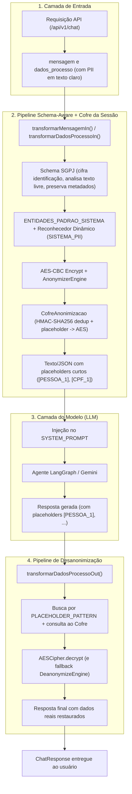

# Arquitetura de Anonimização e Desanonimização Reversível

Este documento descreve detalhadamente o funcionamento, os princípios criptográficos e as implementações do sistema de **anonimização reversível e desanonimização de dados** do `Agent-Backend`, desenvolvido com base no **Microsoft Presidio** e no **spaCy**.

---

## 1. Visão Geral e Princípio de Funcionamento

O objetivo deste módulo é garantir a **privacidade de dados sensíveis (PII)** e a conformidade com a **LGPD (Lei Geral de Proteção de Dados)**, impedindo que informações pessoais e confidenciais de processos jurídicos e clientes sejam enviadas em texto aberto para Provedores de Modelos de Linguagem (LLMs, ex: Google Gemini, OpenAI).

### Anonimização Reversível com Placeholders Curtos, Cofre Criptográfico e Schema SGPJ

Ao contrário da anonimização destrutiva (como substituição fixa por `<CPF>` ou máscara `***`) e diferente do envio direto de strings Base64 longas ao modelo, este sistema combina **criptografia reversível AES-CBC**, **seleção guiada pelo schema do SGPJ** e **placeholders curtos por sessão** (`[TIPO_N]`):

1. **Entrada (Antes do LLM):**
   - Em `dados_processo`, apenas campos sensíveis de identificação/partes (`CAMPOS_CIFRAR_DIRETO`) e textos livres (`CAMPOS_TEXTO_LIVRE`) são anonimizados; metadados jurídicos e de sistema (`CAMPOS_PRESERVADOS`, como `valorCausa`, `prioridade`, `faseProcesso`, `siglaTribunal`, `classeProcessual`, `assunto` e datas) permanecem em texto claro.
   - Em textos livres e na mensagem do usuário, o Presidio restringe a busca a entidades determinísticas/validadas (`ENTIDADES_PADRAO_SISTEMA`) mais um reconhecedor dinâmico (`SISTEMA_PII`) alimentado com os nomes reais extraídos do processo (`extrair_termos_sensiveis_processo`), evitando falsos positivos em siglas como `LGPD`, `SAJ` e `TJSP`.
   - Cada dado sensível identificado é criptografado com **AES-CBC** (IV aleatório de 16 bytes, padding **PKCS7**, codificação **Base64 URL-safe**), armazenado no **Cofre de Anonimização da sessão (`CofreAnonimizacao`)** e substituído no texto por um placeholder curto e legível (ex.: `[PESSOA_1]`, `[ID_1]`, `[CPF_1]`, `[EMPRESA_1]`, `[PROCESSO_CNJ_1]`). Valores idênticos na mesma sessão recebem um resumo determinístico **HMAC-SHA256** e reutilizam o mesmo placeholder sem jamais armazenar texto claro no cofre.
2. **Processamento pelo LLM:** O LLM recebe o contexto contendo apenas os placeholders curtos (`[PESSOA_1]`, `[CPF_1]`, etc.). Como são curtos e estruturados, o modelo consegue correlacionar entidades repetidas (ex.: o mesmo responsável em várias entradas de histórico ou entre turnos) e copiá-los fielmente sem risco de corromper ou alucinar caracteres de um Base64 longo.
3. **Saída (Após o LLM):** Na resposta do modelo, o sistema localiza os placeholders via `PLACEHOLDER_PATTERN`, consulta o respectivo token AES no cofre da sessão, executa a descriptografia (`AESCipher.decrypt`) e restaura os valores originais antes de entregar a resposta na API. Também é mantido um fallback de compatibilidade para descriptografar tokens AES-CBC diretos via `DeanonymizeEngine`.



---

## 2. Estrutura de Diretórios

O módulo de anonimização foi organizado em um subpacote dedicado para manter a codebase limpa e modular:

```
src/app/services/anonymizer/
├── __init__.py           # Exporta a interface pública limpa do módulo e utilitários do cofre
├── recognizers.py        # 6 Recognizers brasileiros com algoritmos de validação
├── engine.py             # Configuração e inicialização singleton dos motores Presidio
└── service.py            # CofreAnonimizacao por sessão, placeholders curtos e fallback AES
```

---

## 3. Detalhamento dos Recognizers Personalizados (`recognizers.py`)

Arquivo: [`src/app/services/anonymizer/recognizers.py`](file:///C:/Users/leona/OneDrive/Área%20de%20Trabalho/Agent-Backend/src/app/services/anonymizer/recognizers.py)

Cada classe estende `PatternRecognizer` da biblioteca `presidio_analyzer` e implementa o método `validate_result(self, pattern_text: str) -> bool`. Quando este método retorna `True`, o Presidio eleva a pontuação da detecção para o valor máximo (`1.0`); quando retorna `False`, o resultado é descartado (`score = 0.0`), prevenindo falsos positivos.

### 3.1. `CpfRecognizer` (Entidade: `BR_CPF`)

Detecta o Cadastro de Pessoas Físicas em formatos pontuados e puramente numéricos.

- **Padrões Regex:**
  - `cpf_formatado`: `\b\d{3}\.\d{3}\.\d{3}-\d{2}\b` (score base: `0.85`)
  - `cpf_apenas_digitos`: `\b\d{11}\b` (score base: `0.40`)
- **Palavras de Contexto:** `"cpf"`, `"cadastro de pessoa fisica"`, `"documento"`, `"titular"`, `"beneficiario"`.
- **Função `validate_result(pattern_text)`:**
  1. Extrai apenas os dígitos numéricos.
  2. Verifica se o comprimento é igual a 11 e rejeita sequências com todos os dígitos iguais (ex: `111.111.111-11`).
  3. Calcula o **1º Dígito Verificador**:
     $$\text{d}_1 = \left(\sum_{i=0}^{8} \text{digito}_i \times (10 - i) \times 10 \pmod{11}\right) \pmod{10}$$
  4. Calcula o **2º Dígito Verificador**:
     $$\text{d}_2 = \left(\sum_{i=0}^{9} \text{digito}_i \times (11 - i) \times 10 \pmod{11}\right) \pmod{10}$$
  5. Retorna `True` se ambos coincidirem exatamente com os dígitos do CPF analisado.

---

### 3.2. `CnpjRecognizer` (Entidade: `BR_CNPJ`)

Suporta tanto o **CNPJ numérico tradicional** quanto o novo **CNPJ Alfanumérico**, regulamentado pela **Instrução Normativa RFB nº 2.229/2024**.

- **Estrutura Suportada:**
  - 14 caracteres: 12 caracteres alfanuméricos (`0-9` e `A-Z`) na raiz e ordem/filial + 2 dígitos verificadores obrigatoriamente numéricos.
  - Formatado: `XX.XXX.XXX/XXXX-NN` (ex: `09.904.401/0001-40`, `E7.ZQS.52V/0001-08`).
  - Sem formatação: 14 caracteres diretos (ex: `12ABC34501DE35`).
- **Padrões Regex:**
  - `cnpj_formatado`: `(?<![0-9A-Za-z])\b[0-9A-Za-z]{2}\.[0-9A-Za-z]{3}\.[0-9A-Za-z]{3}/[0-9A-Za-z]{4}-\d{2}(?![0-9A-Za-z])\b`
  - `cnpj_sem_formato`: `(?<![0-9A-Za-z])\b[0-9A-Za-z]{12}\d{2}(?![0-9A-Za-z])\b`
- **Função `validate_result(pattern_text)`:**
  1. Normaliza a string removendo separadores e aplicando `.upper()`.
  2. Rejeita strings com tamanho diferente de 14 ou caracteres todos repetidos.
  3. Valida se as duas últimas posições são dígitos numéricos.
  4. Converte cada caractere conforme a **regra oficial da Receita Federal (Tabela ASCII)**:
     $$\text{valor} = \text{ord}(c) - 48$$
     *(Dígitos '0'-'9' valem de 0 a 9; letras 'A'-'Z' valem de 17 a 42).*
  5. Aplica os pesos do Módulo 11:
     - Pesos 1º DV: `[5, 4, 3, 2, 9, 8, 7, 6, 5, 4, 3, 2]`
     - Pesos 2º DV: `[6, 5, 4, 3, 2, 9, 8, 7, 6, 5, 4, 3, 2]`
  6. Se o resto da divisão por 11 for 0 ou 1, o DV é 0; caso contrário, é $11 - \text{resto}$.

---

### 3.3. `RgRecognizer` (Entidade: `BR_RG`)

Reconhece Carteiras de Identidade estaduais emitidas pelas Secretarias de Segurança Pública (SSP, Detran, etc.).

- **Padrões Regex:**
  - `rg_formatado_padrao`: `(?<!\d)\b\d{1,2}\.\d{3}\.\d{3}-[\dXx](?![\dXx])\b` (permite dígito verificador numérico ou `X`/`x`).
  - `rg_formatado_sem_hifen`: `(?<!\d)\b\d{1,2}\.\d{3}\.\d{3}(?![\d/])\b` (utiliza o lookahead negativo `(?![\d/])` para impedir que o prefixo de um CNPJ seja identificado erroneamente como RG).
  - `rg_sem_formato`: `(?<!\d)\b\d{7,8}[\dXx](?![\dXx])\b` (score base baixo de 0.35, ativado mediante contexto).
- **Palavras de Contexto:** `"rg"`, `"identidade"`, `"registro geral"`, `"cedula de identidade"`, `"carteira de identidade"`, `"ssp"`, `"detran"`, `"expedicao"`, `"emissor"`.
- **Função `validate_result(pattern_text)`:**
  - Descarta sequências com todos os dígitos repetidos (ex: `00.000.000-0`).

---

### 3.4. `BrazilPhoneRecognizer` (Entidade: `PHONE_NUMBER`)

Substitui e estende o reconhecedor nativo do Presidio, solucionando a falha que impedia a detecção de telefones fixos (como `1103030303` ou `(11) 0303-0303`).

- **Padrões Regex:**
  1. `br_phone_celular_formatado`: `(?<!\d)(?:\+?55\s?)?(?:\([1-9][0-9]\)\s?|[1-9][0-9]\s?)9\s?\d{4}[-\s]?\d{4}(?!\d)`
  2. `br_phone_fixo_formatado`: `(?<!\d)(?:\+?55\s?)?(?:\([1-9][0-9]\)\s?|[1-9][0-9]\s?)[0-9]\d{3}[-\s]?\d{4}(?!\d)`
  3. `br_phone_local_formatado`: `(?<!\d)(?:9\s?\d{4}|[0-9]\d{3})[-\s]\d{4}(?!\d)`
  4. `br_phone_0800`: `(?<!\d)0[38]00[-\s]?\d{3}[-\s]?\d{4}(?!\d)`
  5. `br_phone_celular_sem_formato`: `(?<!\d)(?:\+?55)?[1-9][0-9]9\d{8}(?!\d)` (exatamente 11 dígitos com 9 na 3ª posição).
  6. `br_phone_fixo_sem_formato`: `(?<!\d)(?:\+?55)?[1-9][0-9][0-9]\d{7}(?!\d)` (exatamente 10 dígitos, ex: `1103030303`).
- **Palavras de Contexto:** `"telefone"`, `"celular"`, `"tel"`, `"contato"`, `"whatsapp"`, `"whats"`, `"fone"`, `"fixo"`, `"ligar"`.

---

### 3.5. `RazaoSocialRecognizer` (Entidade: `BR_RAZAO_SOCIAL`)

Identifica nomes corporativos e razões sociais no Brasil, corrigindo a falha do spaCy que classificava empresas terminadas em nomes próprios ou siglas como `PERSON` ou `LOCATION`.

- **Sufixos Jurídicos Suportados:**
  `LTDA`, `Ltda.`, `LIMITADA`, `S.A.`, `S/A`, `EIRELI`, `ME`, `M.E.`, `EPP`, `E.P.P.`, `MEI`, `S/S`, `SPE`, `CIA`, `COMPANHIA`, `HOLDING`.
- **Filtro de Início Negativo:**
  Impede a captura de palavras introdutórias da frase (como `"Contrato com"`, `"A empresa"`, `"Fornecedor"`).
- **Padrão Regex:**
  Exige palavras capitalizadas/conectivos seguidas obrigatoriamente por um dos sufixos jurídicos:
  ```regex
  \b(?!Contrato\b|Empresa\b|Fornecedor\b|Cliente\b|Entre\b|Pela\b|Pelo\b|Com\b)(?:[A-ZÀ-Ú][a-zà-ú0-9]+|[A-ZÀ-Ú0-9]{2,})(?:\s+(?:(?:[A-ZÀ-Ú][a-zà-ú0-9]+|[A-ZÀ-Ú0-9]{2,})|(?:de|da|do|dos|das|e|em|para|com|&|\-))){1,8}\s+(?:LTDA\.?|...)(?!\w)
  ```
- **Score (0.90):** Superior ao modelo padrão do spaCy (`0.85`), garantindo que o Presidio priorize a entidade `BR_RAZAO_SOCIAL`.

---

### 3.6. `CnjRecognizer` (Entidade: `BR_CNJ`)

Identifica o Número Único de Processos do Poder Judiciário conforme a **Resolução nº 65/2008 do Conselho Nacional de Justiça (CNJ)**.

- **Estrutura (20 dígitos):**
  $$\text{NNNNNNN-DD.AAAA.J.TR.OOOO}$$
  - `NNNNNNN` (7): Número sequencial
  - `DD` (2): Dígitos verificadores
  - `AAAA` (4): Ano do ajuizamento
  - `J` (1): Órgão da Justiça (1: STF, 2: CNJ, 3: STJ, 4: Federal, 5: Trabalho, 6: Eleitoral, 7: Militar União, 8: Estadual, 9: Militar Estadual)
  - `TR` (2): Tribunal respectivo
  - `OOOO` (4): Unidade de origem / Vara
- **Padrões Regex:**
  - `cnj_formatado`: `(?<!\d)\b\d{7}-\d{2}\.\d{4}\.[1-9]\.\d{2}\.\d{4}\b` (score base: `0.90`)
  - `cnj_sem_formato`: `(?<!\d)\b\d{13}[1-9]\d{6}(?!\d)` (score base: `0.40`)
- **Função `validate_result(pattern_text)`:**
  1. Extrai os 20 dígitos numéricos e valida o dígito `J` entre 1 e 9.
  2. Aplica o cálculo matemático do **Módulo 97 (norma ISO 7064)**:
     $$\text{Concatenação}(NNNNNNN, AAAA, J, TR, OOOO, DD) \pmod{97} \equiv 1$$
  3. Se o resto for rigorosamente igual a `1`, o número é autêntico e válido.

---

## 4. Inicialização dos Motores (`engine.py`)

Arquivo: [`src/app/services/anonymizer/engine.py`](file:///C:/Users/leona/OneDrive/Área%20de%20Trabalho/Agent-Backend/src/app/services/anonymizer/engine.py)

Implementa o padrão **Singleton com Carregamento Preguiçoso (Lazy Loading)** para evitar carregamentos repetidos de modelos em memória.

### Funções:

- **`_init_engines()`**:
  - Configura o `NlpEngineProvider` do Presidio para carregar o modelo spaCy em português (`pt_core_news_sm`).
  - Cria a instância de `AnalyzerEngine(nlp_engine=..., supported_languages=["pt"])`.
  - Registra os 6 reconhecedores personalizados no `analyzer.registry` para o idioma português.
  - Instancia `AnonymizerEngine()` e `DeanonymizeEngine()`.
  - Armazena as instâncias em variáveis globais de módulo (`_analyzer`, `_anonymizer`, `_deanonymizer`).
- **`get_analyzer_engine()`**: Retorna a instância única do analisador de texto.
- **`get_anonymizer_engine()`**: Retorna a instância única do anonimizador.
- **`get_deanonymize_engine()`**: Retorna a instância única do desanonimizador.

---

## 5. Serviços de Transformação e Cofre da Sessão (`service.py`)

Arquivo: [`src/app/services/anonymizer/service.py`](file:///C:/Users/leona/OneDrive/Área%20de%20Trabalho/Agent-Backend/src/app/services/anonymizer/service.py)

Contém a lógica de negócio para aplicar a anonimização com placeholders curtos, o cofre criptográfico isolado por sessão e a desanonimização na saída do modelo.

### 5.1. `CofreAnonimizacao` e Gerenciamento por Sessão

- **`CofreAnonimizacao`:** Estrutura thread-safe (`threading.Lock`) que mapeia `placeholder -> token_aes_cifrado` (ex.: `"[PESSOA_1]" -> "DJJCE-..."`).
  - **Zero texto claro em memória do cofre:** Para garantir reutilização consistente quando a mesma entidade aparece múltiplas vezes (na mesma mensagem, em listas de histórico ou em turnos subsequentes da sessão), o cofre calcula um resumo determinístico via **HMAC-SHA256** (`hmac(key, valor_normalizado)`) apenas para deduplicação, armazenando exclusivamente o token cifrado em AES.
  - **Prefixos amigáveis (`ENTITY_PREFIX_MAP` e `_obter_prefixo_campo`):** Entidades e campos do schema são convertidos em prefixos legíveis para o LLM: `PESSOA`, `ID`, `CPF`, `CNPJ`, `RG`, `TELEFONE`, `EMPRESA`, `PROCESSO_CNJ`, `EMAIL`, `ENTIDADE`, `LOCAL`, `ORGANIZACAO`, `DADO`, entre outros.
- **`obter_cofre_sessao(session_id: str) -> CofreAnonimizacao`:** Obtém ou inicializa o cofre isolado de uma sessão.
- **`limpar_cofre_sessao(session_id: str) -> bool`:** Descarta o cofre ao encerrar/excluir a sessão.

### 5.2. `extrair_termos_sensiveis_processo` e Reconhecedor Dinâmico (`SISTEMA_PII`)

- **`extrair_termos_sensiveis_processo(dados)`:** Coleta os nomes e identificadores sensíveis das chaves em `CAMPOS_FONTE_TERMOS_CONHECIDOS` e subobjetos de partes (`CONTEXTOS_PARTE_SENSIVEL`), ignorando `CAMPOS_PRESERVADOS`.
- **`_criar_reconhecedor_termos_sistema(termos)`:** Injeta um `PatternRecognizer` dinâmico (`ad_hoc_recognizers`) com a entidade `SISTEMA_PII` para garantir que os nomes reais do processo também sejam mascarados quando citados em campos de texto livre ou na mensagem do usuário.

### 5.3. `anonimizar_texto(texto, key=None, termos_conhecidos=None, mapa_tokens=None, session_id=None, cofre=None)`

- **Entrada:** String de texto em texto claro, chave AES opcional, termos sensíveis extraídos do processo (`termos_conhecidos`), mapa auxiliar (`mapa_tokens`) e identificador de sessão/cofre.
- **Processamento:**
  1. Verifica se o texto já é um placeholder registrado (`_is_placeholder`) ou um token AES válido (`_is_encrypted_token`) para evitar dupla cifragem.
  2. Restringe a análise exclusivamente a entidades estruturadas/validadas (`ENTIDADES_PADRAO_SISTEMA`: `BR_CPF`, `BR_CNPJ`, `BR_RG`, `PHONE_NUMBER`, `EMAIL_ADDRESS`, `BR_CNJ`, `BR_RAZAO_SOCIAL`), desativando o NER aberto do spaCy (`PERSON`, `LOCATION`, `NRP`, `DATE_TIME`) para eliminar falsos positivos em siglas como `"LGPD"`, `"SAJ"` e `"TJSP"`, e injeta `SISTEMA_PII` quando `termos_conhecidos` é fornecido.
  3. Filtra termos na deny-list (`IGNORAR_ENTIDADES`), executa `anonymizer.anonymize()` com `OperatorConfig("encrypt", {"key": encryption_key})` e ordena os itens da esquerda para a direita.
  4. Registra cada token cifrado no `CofreAnonimizacao` ativo e substitui o Base64 longo pelo placeholder curto correspondente (`[PESSOA_1]`, `[CPF_1]`, etc.).
- **Saída:** Tupla com o texto contendo placeholders curtos e a lista de metadados (`start`, `end`, `entity_type`, `text`, `operator`: `"placeholder_aes"`).

### 5.4. `anonimizar_dados_processo(dados, key=None, mapa_tokens=None, session_id=None, cofre=None) -> dict[str, Any] | None`

- **Entrada:** Dicionário com informações contextuais do processo no schema do SGPJ (payload `dados_processo`) e contexto de sessão opcional.
- **Processamento guiado pelo Schema (Key-Aware) + Cofre:**
  - **Cifrados integralmente via `_cifrar_com_cofre` (`CAMPOS_CIFRAR_DIRETO` e `CONTEXTOS_PARTE_SENSIVEL`):** `clientNomeRazaoSocial`, `clienteId`, `usuarioResponsavelNome`, `usuarioResponsavelId`, `numeroCnj` e campos de autoria em `historicoProcessoResponses` recebem cifragem AES no cofre e viram placeholders curtos (`[PESSOA_1]`, `[ID_1]`, `[PROCESSO_CNJ_1]`).
  - **Analisados como texto livre (`CAMPOS_TEXTO_LIVRE` e demais strings):** `descricaoCaso`, `obervacao` (`observacao`) e `ultimoMovimento` passam por `anonimizar_texto()` com `ENTIDADES_PADRAO_SISTEMA` e os nomes das partes extraídos do próprio processo, reutilizando exatamente os mesmos placeholders do cofre.
  - **Preservados em texto claro (`CAMPOS_PRESERVADOS`):** `valorCausa`, `prioridade`, `faseProcesso`, `status`, `dataAudiencia`, `dataHoraInicio`, `ultimaAtualizacao`, `siglaTribunal`, `tribunalTramitacao`, `instancia`, `dataAjuizamento`, `nivelSigilo`, `classeProcessual`, `formato`, `sistemaTribunal`, `orgaoJulgador`, `assunto` e datas/tipos de atualização em `historicoProcessoResponses`.
- **Saída:** Novo dicionário idêntico na sua hierarquia, com apenas os dados sensíveis protegidos por placeholders consistentes e os metadados processuais intactos para o LLM.

### 5.5. `desanonimizar_texto(texto, key=None, session_id=None, cofre=None) -> str`

- **Entrada:** Resposta gerada pelo LLM contendo placeholders `[TIPO_N]` (ou tokens AES diretos).
- **Processamento:**
  1. **Restauração de Placeholders:** Localiza candidatos com `PLACEHOLDER_PATTERN` (`r"\[[A-Z][A-Z0-9_]*_\d+\]"`), consulta o token AES correspondente no cofre da sessão e o decifra com `AESCipher.decrypt`. Placeholders desconhecidos são mantidos intactos.
  2. **Fallback para Tokens AES Diretos:** Em seguida, busca eventuais tokens AES-CBC diretos com `ENCRYPTED_TOKEN_PATTERN` (`r"[A-Za-z0-9_-]{43,}={0,2}"`), tratando também casos envolvidos em itálico Markdown (`_TOKEN_`) e restaurando-os via `DeanonymizeEngine`. Candidatos com sufixo `=` que falharem na decifragem registram `logger.warning` para observabilidade.
- **Saída:** String com todos os dados sensíveis restaurados na sua forma original em texto legível.

---

## 6. Integração no `agent_service.py` e `prompts.py`

Arquivos: [`src/app/services/agent_service.py`](file:///C:/Users/leona/OneDrive/Área%20de%20Trabalho/Agent-Backend/src/app/services/agent_service.py) e [`src/app/agent/prompts.py`](file:///C:/Users/leona/OneDrive/Área%20de%20Trabalho/Agent-Backend/src/app/agent/prompts.py)

A orquestração do pipeline de chat conecta a anonimização por sessão e a desanonimização através das funções abaixo:

### 6.1. `transformarMensagemIn` e `transformarDadosProcessoIn`

```python
def transformarMensagemIn(
    mensagem: str,
    dadosProcesso: dict[str, Any] | None = None,
    termosConhecidos: Sequence[str] | None = None,
    mapaTokens: dict[str, str] | None = None,
    idSessao: str | None = None,
) -> str:
    """Anonimiza os dados sensíveis do texto enviado pelo usuário antes do envio ao agente/LLM."""
    ...

def transformarDadosProcessoIn(
    dadosProcesso: dict[str, Any] | None,
    mapaTokens: dict[str, str] | None = None,
    idSessao: str | None = None,
) -> dict[str, Any] | None:
    """Anonimiza os dados sensíveis do processo antes do envio ao agente/LLM."""
    ...
```

- **Momento de Execução:** Executadas em `executarPipelineAgente()` imediatamente antes de `agent.ainvoke()`, compartilhando o mesmo `idSessao`, o cache `_sessao_termos_conhecidos` e o `CofreAnonimizacao` da sessão.
- **Efeito:** Garante que a mensagem do usuário e o estado `dados_processo` enviados ao LLM contenham exclusivamente placeholders curtos e consistentes entre turnos, preservando siglas jurídicas e metadados do processo, enquanto o `CofreAnonimizacao` da sessão guarda apenas os valores cifrados em AES.
- **Orientação no Prompt:** A seção `4.1. DADOS CRIPTOGRAFADOS` do `SYSTEM_PROMPT` instrui o modelo a reproduzir os placeholders `[TIPO_N]` exatamente como aparecem (sem envolver em `{}` e sem alterar caracteres).

### 6.2. `transformarDadosProcessoOut` e `excluirSessao`

```python
def transformarDadosProcessoOut(message: Any, idSessao: str | None = None) -> Any:
    """Restaura dados sensíveis presentes na resposta do agente/LLM."""
    if not isinstance(message, str):
        return message

    return desanonimizar_texto(message, session_id=idSessao)
```

- **Momento de Execução:** `transformarDadosProcessoOut()` é executada logo após extrair o conteúdo textual da última mensagem retornada pelo modelo (`mensagens[-1].content`), utilizando o cofre da sessão `idSessao`.
- **Limpeza de Sessão:** Ao chamar `excluirSessao(idSessao)` (via `DELETE /api/v1/chat/{session_id}` ou `/limpar` no `run_local.py`), além de remover a thread no `InMemorySaver`, o sistema limpa `_sessao_termos_conhecidos`, `_sessao_mapa_tokens` e invoca `limpar_cofre_sessao(idSessao)` para descartar o cofre criptográfico da sessão.

---

## 7. Configurações e Gerenciamento de Chaves (`settings.py`)

Arquivo: [`src/app/config/settings.py`](file:///C:/Users/leona/OneDrive/Área%20de%20Trabalho/Agent-Backend/src/app/config/settings.py)

A chave simétrica utilizada pelo algoritmo AES é carregada via Pydantic Settings:

```python
class Settings(BaseSettings):
    llm_api_key: str
    llm_model: str
    anonymization_key: str = "1111222233334444"  # Chave padrão de 16 bytes (128 bits)
```

- O tamanho da chave deve ter exatamente **16 bytes (128 bits)**, **24 bytes (192 bits)** ou **32 bytes (256 bits)**.
- Em ambientes de produção, a chave deve ser definida no arquivo `.env` ou nas variáveis de ambiente do sistema operacional:
  ```env
  ANONYMIZATION_KEY="chave-secreta-32-bytes-supersegura!"
  ```

---

## 8. Verificação e Testes Unitários

A integridade de todas as rotinas é validada através dos arquivos [`tests/test_anonymizer.py`](file:///C:/Users/leona/OneDrive/Área%20de%20Trabalho/Agent-Backend/tests/test_anonymizer.py) e [`tests/test_service.py`](file:///C:/Users/leona/OneDrive/Área%20de%20Trabalho/Agent-Backend/tests/test_service.py):

| Teste | O que valida |
| :--- | :--- |
| `test_reconhecedor_cpf` | Detecção de CPFs válidos e descarte de CPFs com dígitos verificadores incorretos. |
| `test_reconhecedor_cnpj_tradicional_e_alfanumerico` | Detecção de CNPJs tradicionais e alfanuméricos formatados e sem formatação (IN 2.229/2024). |
| `test_reconhecedor_rg` | Detecção de RGs com traço, dígitos numéricos e dígito `X`. |
| `test_reconhecedor_telefone_celular_e_fixo` | Detecção de telefones celulares (11 dígitos) e fixos (10 dígitos, ex: `1103030303`). |
| `test_reconhecedor_razao_social` | Detecção de nomes empresariais com sufixos `Ltda.` e `S.A.`. |
| `test_reconhecedor_cnj` | Detecção e validação matemática por Módulo 97 de processos judiciais. |
| `test_anonimizacao_reversivel_e_desanonimizacao_texto` | Garante que `desanonimizar(anonimizar(texto)) == texto`. |
| `test_anonimizar_dados_processo_dicionario` | Travessia de dicionários preservando campos numéricos/booleanos e mascarando dados pessoais/documentos. |
| `test_schema_sgpj_anonimiza_apenas_campos_sensiveis_e_preserva_metadados` | Valida proteção seletiva por schema SGPJ, preservação de siglas (`LGPD`, `SAJ`, `TJSP`) e restauração na mensagem do usuário. |
| `test_transformar_dados_processo_in_e_out` | Fluxo completo de ponta a ponta simulando a resposta do LLM e a restauração. |
| `test_nao_censura_siglas_juridicas_lgpd_nem_comandos_do_usuario` | Garante que siglas jurídicas (`LGPD`, `CNJ`, `SAJ`, `TJSP`) e comandos usuais não sejam censurados. |
| `test_placeholders_curtos_e_reutilizacao_na_mesma_sessao` | Geração de placeholders curtos (`[TIPO_N]`), reutilização determinística em listas repetidas, armazenamento apenas cifrado no cofre e limpeza da sessão. |
| `test_isolamento_entre_sessoes_e_fallback_aes_direto` | Isolamento completo entre sessões diferentes e compatibilidade retroativa com tokens AES-CBC diretos (incluindo itálico Markdown). |
| `test_pipeline_reutiliza_placeholder_entre_turnos_e_limpa_ao_excluir_sessao` | Reutilização de placeholders entre `dados_processo` e turnos seguintes da mesma sessão e limpeza automática via `excluirSessao()`. |

### Como Executar os Testes:

```powershell
$env:LLM_API_KEY="mock"; $env:LLM_MODEL="mock"; $env:PYTHONPATH="."; python -m unittest discover tests
```
