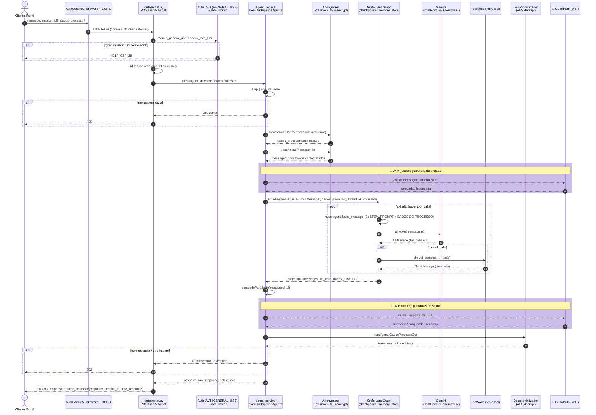
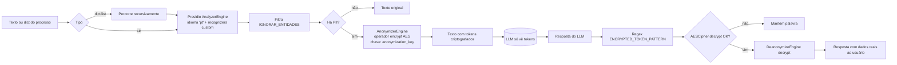
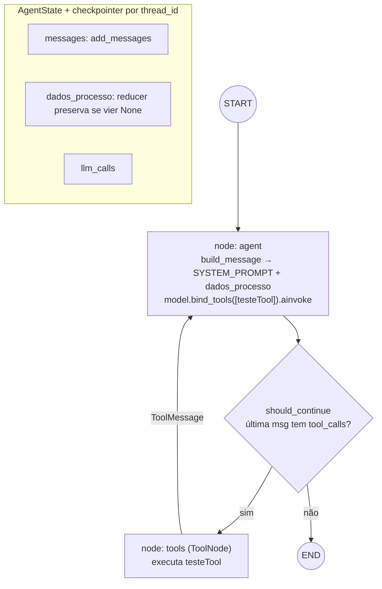
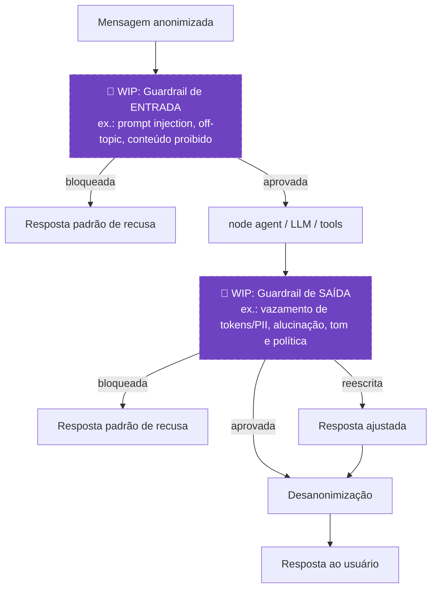
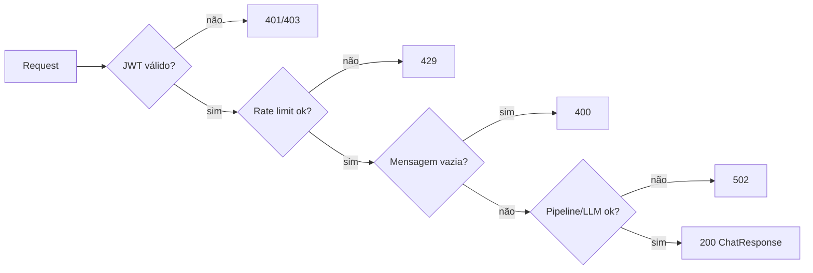

# Fluxo do Agente MarIA

## 1. Visão geral (sequência ponta a ponta)

## 2. Anonimização / desanonimização

## 3. Grafo LangGraph (nodes, edges e estado)

## 4. 🚧 Guardrails (WIP — ainda não implementado)

> [!WARNING]
> Seção **Work In Progress**: os guardrails ainda não existem no código. Posições e comportamentos abaixo são planejados e podem mudar.

Ponto de integração previsto: em `executarPipelineAgente`, antes do `ainvoke` (entrada) e antes de `transformarDadosProcessoOut` (saída). A alternativa é incluí-los como nodes no grafo LangGraph.

## 5. Mapa de erros

> [!NOTE]
> Hoje há apenas uma tool (`testeTool`). Novas tools entram na lista `ferramentas` em `agent/agent.py` e o `ToolNode` as expõe automaticamente ao LLM, que escolhe qual chamar via `tool_calls`.
